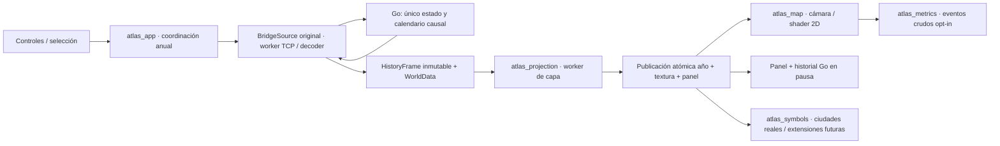

# Arquitectura seleccionada: observador Godot 2D independiente

Base de producto: PR #26 `10258dd1`. Selección provisional de Misión A;
mediciones de la Iris Xe siguen pendientes. Véase comparación tecnológica.

Sin cambios en `internal`, `cmd`, protocolo o dependencias. El stage genera un
proyecto propio desde este directorio y copia ocho adaptadores exactos existentes,
con manifiesto SHA. El cliente 3D mantiene todos sus recursos y rutas. Evita
commitear una segunda implementación del transporte; la futura extracción de
un paquete compartido no se anticipa sin necesidad.

`WorldData` verifica el SHA/offsets/tipos del bundle ASABGEO. La elevación fina,
temperatura y precipitación se suben una vez como texturas RF. El shader aplica
paleta física y sombreado derivado de pendientes, sin ruido o terreno añadido.
Costa = signo de elevación fina. La asignación costera usa `land_remap` existente;
picking y shader usan los mismos texeles finos y la misma regla. Provincia ID
row-major permanece intacta. X se repite en la cámara; Y está acotada. Relieve
no tiene sombras 3D, luces ni geometría de terreno.

La capa elegida pasa por MapLayers en un worker y se sube en el hilo principal.
Se publica mapa/panel/año juntos. Sólo se permite un año TCP en vuelo; al recibir
un año se detiene la solicitud continua hasta publicar su proyección. No se
filtran publicaciones anuales durante reproducción. El cambio de capa reconstruye
el mismo frame o el siguiente pendiente, sin insertar frames anteriores. Pausa
acepta el año ya en curso y pide estado exacto. SHA diferido sigue marcado y
nunca se fabrica. La revisión de frames retenidos no envía comandos de retroceso.

El panel usa el frame presentado. Consultas de detalle/historial sólo en pausa,
sobre último año; las respuestas se descartan si selección/año cambian. Las
ciudades proceden de HistoryFrame.settlements; la población de esos registros es
un proxy provincial. Símbolos y etiquetas aparecen por escala, una decisión
funcional de legibilidad. No hay caché de entidades de edificios ni ruinas
ficticias. El futuro contrato causal debe definir identidad, ubicación y vigencia.

## Estructura mínima futura y PR independientes

Mantener `internal/{sim,rng,mapsource,interop}` y `client/godot` en sus rutas.
`experiments/atlas2d/{godot,tools,probes,tests,docs,evidence}` contiene el experimento.
`build/atlas2d` contiene todo generado. No hace falta reorganizar todo el repo
para probar el nuevo observador.

| PR posterior propuesta | Riesgo | Prueba/criterio exigible |
|---|---|---|
| Esta Misión A, borrador independiente sobre #21 | Sesiones, años, IDs, export | SHA directo Go vs observador; reproducción/pausa/revisión; picking/remap; export Windows; captura real pendiente |
| Documentación de entrada y decisión de integración de #21/#26 | Confundir base integrada y especificación | Tabla de SHAs, comandos ejecutables desde checkout limpio; autorización de integración separada |
| Kit de una orden para descargar/compilar/medir ambos clientes | Versiones/paths/cache/Windows | Hashes fijados; checkout limpio y ruta con espacios; Windows sin herramientas para paquete; no cambiar presets 3D |
| Extraer adaptadores neutrales compartidos, sólo si se mantiene Atlas | Romper class_name/UID/rutas o contrato | Consumidores 2D y 3D, export ambos, publicaciones/deltas/replay/SHA iguales |
| Leyendas/búsqueda/accesibilidad del Atlas | Interpretación errónea de datos | Escalas/unidades y ausencia de datos explícitas; consultas por ID, sin cambios Go |
| Caché/regiones/diferenciales según captura Iris Xe | Invalidación, costas/selección y años mezclados | A/B mismo snapshot/cámara; P95/P99, RAM; igualdad de colores/IDs; no degradar fidelidad sin decisión |
| Tierra real versionada (etapa posterior) | Cambiar IDs, RNG, geografía y replays existentes | Dataset/licencia/hash/versionado; mundos procedural previos reproducibles; separar de optimización |

Cada PR debe poder revisarse/revertirse sin reescribir historia ni borrar otro
cliente. La reorganización de Go requiere preservar module/internal boundaries;
la de Godot requiere UID/rutas de preload/load, escenas, imports y export; la de
recursos requiere consumidores de shaders, binarios, fixtures y licencias.
