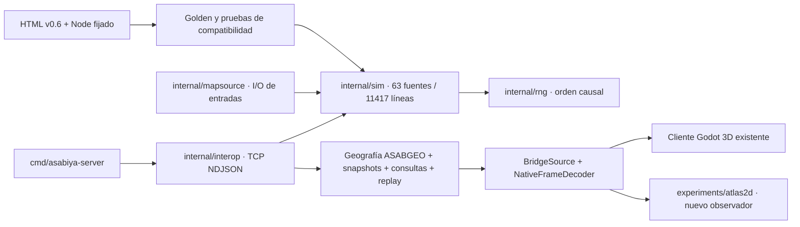

# Auditoría verificada — 22 de octubre de 2026

## Integración y dependencias

| Referencia inspeccionada | HEAD verificado | Contenido efectivo |
|---|---|---|
| main | `714d06c3a9d3ce9d69dbb184161a99b2c78e82f1` | Geografía; no contiene toda la consolidación histórica/cliente |
| PR #21 | `79035761f1e61041a3ccbf74b648577e53ba7150` | Consolidación Go + Godot + contrato + pruebas; base experimental |
| PR #22 | `2193a9d92400e7398c73c79105e311aae6397d3b` | 19 commits sobre #21; rendimiento cliente 3D |
| PR #25 | `d20d13e404e6edbd320a59350e1b6f503bc6c2d2` | Sobre PR #24 (`431a7dd`), que parte de #22; shaders/kit 3D |
| PR #26 | `10258dd16763a92e5ad0c5194f0e600e827ecad5` | Documentación Atlas 2D sobre main; no integra el motor |

`git diff 79035761 d20d13e4 -- internal cmd go.mod go.sum reference tests/native client/exporter`
resultó vacío. El motor integrado más reciente entre estas PR es idéntico a #21;
las mejoras posteriores inspeccionadas son cliente/herramientas/documentación.
No se considera que #21 esté integrada en main. Esta rama parte exactamente de
su SHA, sin fusionar #22/#25/#26. La dirección de #26 se aplica como especificación,
no como merge. No se modificó el estado de otras PR. En la comprobación posterior de esta
misión, #22 figuraba cerrada y no fusionada, con el mismo HEAD; #21/#25/#26
seguían abiertas. No se atribuye aquí esa transición a una persona o herramienta.

## Mapa del repositorio en la base #21

367 archivos versionados, aproximadamente 17 MB. `internal`: 121 archivos,
0,60 MB; `client`: 90, 0,51 MB; `tests`: 16, 12,34 MB; `reference`: 3, 1,55 MB;
`docs`: 54, 0,65 MB; `tools`: 32, 0,09 MB; `.github`: 7 workflows.
Son tamaños de archivos versionados, no binarios/cachés de compilación.

`internal/interop`: 7 fuentes de producción / 1180 líneas. Godot #21:
27 scripts de producción / 7566 líneas. Los seis archivos Go mayores son
language 540, omens 431, crises 421, politics 418, history 395, wars 389 líneas;
el tamaño por sí solo **no demuestra** exceso de responsabilidad.
Dependencias: Go 1.27.2, stdlib + RNG interno para sim; Ebitengine 2.10.5
(y purego/gomobile/x/sys/x/sync/hideconsole) en la presentación Go provisional;
Godot 4.7.2 oficial, TCP local sin biblioteca de red externa; Node fijado para
oráculo legado. No se añaden dependencias de producción.

## Diez problemas estructurales prioritarios

| # | Hecho y ruta/evidencia | Consecuencia y acción mínima |
|---|---|---|
| 1 | `main` no contiene `internal/sim` histórico/cliente equivalentes a #21; relación Git anterior | Documentar SHA/base en cada entrega; integrar sólo mediante aprobación futura. No desarrollar suponiendo main completo. |
| 2 | `AGENTS.md` acumula instrucciones contradictorias de ramas, propiedad y pruebas r3–r5; #26 propone 2D sobre main | Precedencia explícita de misión en este directorio; consolidar raíz en una PR documental posterior aprobada. |
| 3 | `client/godot/scripts/ui/hud.gd`: 1733 líneas; `app/main.gd`: 1044 | Mezclan controles, consultas, selección y presentación 3D. Atlas implementa su UI pequeña separada; no trasladar todo HUD ni reescribirlo ahora. |
| 4 | `data/bridge_source.gd`: 737 líneas, proceso, TCP, sesiones, worker, reproducción, consultas, preparación | Reutilizar exacto con pruebas de frontera; extraer transporte sólo si hay cambio necesario y dos consumidores probados. No duplicar el protocolo en otro motor sin coste explícito. |
| 5 | `MapLayers` mezcla catálogo, colores y proyección; `NativeFrameDecoder._color` lo referencia | Adaptador no completamente independiente de presentación. Stage incluye MapLayers con hash. Separar color/catálogo sería PR propia; no borrar por parecer exclusivo de 3D. |
| 6 | `state_digest.go` codifica estructura por reflexión; golden depende de nombres/orden/tipos | Mover/renombrar structs puede cambiar SHA sin gameplay visible. Mantener motor intacto; exigir digest/replay/RNG en cualquier cambio futuro. |
| 7 | `client/tools/build-client.ps1` y workflows descargan engine/templates grandes, exportan cliente/mundo | Crear paquete 2D separado, herramientas fijadas y manifiesto. Una extracción común podría reducir mantenimiento después; no cambiar pipeline 3D en esta misión. |
| 8 | #25 corrige errores del kit #24: PID consola y preparación limitada por frames | Atlas usa PID informado por Godot y encadenador explícito existente. Verificar captura completa y SHA al finalizar; no tomar tiempo de launcher como consumo. |
| 9 | `docs/design` de #26, README/AGENTS de #21 y documentación 3D mantienen prioridades distintas | Referenciar versión rectora y alcance de cada documento. Es duplicación semántica confirmada, no prueba de que un archivo carezca de consumidores. Conservar historial y art direction. |
| 10 | Publicaciones, historia retenida y métricas tienen resoluciones distintas: 24 frames cliente, propiedad 10 años, SHA diferido explícito, ciudades con proxy provincial | Mostrar límites en UI/docs y fijarlos en pruebas; no presentar proxies como censos urbanos, SHA vacío como verificado ni inferir ruinas. |

## Redundancia, generación y conservación

`build/`, ejecutables exportados, caché `.godot` y staging son generados;
`build/` ya está ignorado. No son sustitutos de fuentes, ni se borran fuentes de
los que dependen. Los ocho scripts compartidos tienen consumidores 3D y Atlas
(stage y manifiesto); **no son prescindibles**. La presentación Ebitengine
provisional tiene consumidores de comandos/build existentes y ahora microprobe;
no se elimina. Los `.uid` son identidades Godot: no mover recursos sin revisar
referencias UID/rutas/import/export. No se recomienda borrar ninguno.

Los 12,34 MB de tests son mayormente golden del mundo; workflows native y
pruebas los consumen. El HTML v0.6 es referencia del oráculo y su hash está fijado:
`988ce360e70d2d034a3898f60b9a4c38d40b0ab56dd7a147329740f15fa8e9e9`.
Se conservan fixtures, documentación histórica, contratos y todo el cliente 3D.
No se ha demostrado que ningún archivo fuente/documento sea eliminable.

Hipótesis por comprobar: unificar descargas y paneles puede reducir mantenimiento;
regionalizar, cachear capas o publicar diferencias podría mejorar rendimiento.
No se atribuye el antiguo caso de 13 FPS a GPU/CPU sin medición emparejada ni se
traslada esa conclusión al nuevo 2D.
